  

# 🎧 Awesome-Audio-AI-Spatial-Audio-Synthesis 🚀

  
  
  
  
  
  
  

---

## 🌟 Top Audio AI & Spatial Audio Synthesis Ecosystem

> **Curated directory of SaaS/hosted platforms & open-source GitHub projects**  
> *Targeted at Neural Audio Generation, 3D Spatial Audio Rendering, HRTF Binaural Sound, Speech Enhancement, Voice Cloning & Digital Audio Workstations (DAWs)*  
> **📅 Last updated: November 2026**

Welcome to **Awesome Audio AI & Spatial Audio Synthesis**! This repository tracks state-of-the-art **cloud SaaS solutions**, foundational **deep learning models**, and battle-tested **open-source DSP frameworks** driving modern audio innovation. Whether you are building immersive XR soundscapes, synthesizing realistic multi-speaker dialogues, automating podcast mastering, or fine-tuning neural audio codecs, this directory provides the most comprehensive roadmap of tools and benchmarks.

### 🔍 Key Categories Covered
- 🎙️ **Neural Voice & Speech Synthesis:** Autoregressive and flow-matching text-to-speech (TTS), zero-shot voice cloning, and expressive dialogue generation.
- 🎧 **3D Spatial Audio & Ambisonics:** Head-Related Transfer Function (HRTF) filtering, raytraced room impulse simulation, Higher-Order Ambisonics (HOA), and binaural rendering engines.
- ✨ **AI Speech Enhancement & Restoration:** Real-time deep noise suppression, reverberation removal, harmonic super-resolution, and neural source separation.
- 🎛️ **Generative Music, SFX & DAWs:** Text-to-audio diffusion models, neural audio codecs (EnCodec, SoundStream), and modular node-based audio workstations.

---

## 📑 Table of Contents

- [📊 Sector Overview & Market Dynamics](#-sector-overview--market-dynamics)
- [☁️ SaaS/Hosted Platforms](#️-saashosted-platforms)
- [💻 Open-Source GitHub Projects](#-open-source-github-projects)
- [🤝 How to Contribute](#-how-to-contribute)
- [💖 Support & Sponsorship](#-support--sponsorship)
- [📈 Star History](#-star-history)
- [📜 Disclaimer](#-disclaimer)

---

## 📊 Sector Overview & Market Dynamics

The global **Audio AI market** is estimated at **~$34.2 billion** (projected to expand to **$117.5 billion by 2033** at a **19.3% CAGR**), while the **3D / Spatial Audio market** stands at **~$7–8 billion** (projected to surge past **$27–38 billion** across game engines, XR hardware, streaming, and automotive cabins by the early 2030s at a **15–22% CAGR**). 

The ecosystem is **moderately fragmented**: foundational spatial audio formats and distribution pipelines remain anchored by industry tech leaders (*Dolby Atmos, Apple Spatial Audio, Sony 360 Reality Audio*), while fast-moving machine learning startups and open-source models pioneer edge AI processing, diffusion vocoders, and zero-shot voice cloning.

---

## ☁️ SaaS/Hosted Platforms

The following table compares premier hosted and SaaS audio platforms, including transparent starting tier prices, specific free plan/trial limits, and company size rankings:

| Product | 🏢 Company Size (Valuation / Revenue) | 💳 Starting Paid Pricing | 🎁 Free Tier Limits | 📝 Description |
| :--- | :--- | :--- | :--- | :--- |
| **[Adobe Podcast (Enhance Speech)](https://podcast.adobe.com/)** | Market Cap: ~$85B–$88B (FY Revenue: ~$25.9B) | $9.99 / month (Adobe Express / Firefly bundle) | **Free plan:** Max 30 min duration (or 500 MB) per file, up to 1 hour daily enhancement limit | Browser-based AI voice restoration and audio synthesis tool transforming noisy, echo-heavy recordings into studio-quality vocal tracks. |
| **[Dolby.io](https://dolby.io)** | Market Cap: ~$5.1B–$6.0B (Annual Revenue: ~$1.42B) | Usage-based: Media Enhance from $0.05/min; Communications from $0.0025–$0.0045/participant-min | **Free plan:** $25 monthly recurring credit on pay-as-you-go ($50 initial signup credit) + 50 GB free monthly real-time streaming bandwidth | Cloud media and communications API platform providing spatial audio synthesis, AI speech enhancement, dynamic leveling, and multi-channel mastering. |
| **[Descript (Studio Sound & Overdub)](https://descript.com)** | Valuation: ~$550M (ARR: ~$50M–$55M; $101M raised) | $16 / editor / month (billed annually) or $24 / month (Hobbyist) | **Free plan:** 1 hour (60 min) transcription/editing per month, 100 one-time AI credits, 720p watermarked export, 5 GB storage | AI-powered audio and video production suite combining text-based transcript editing, neural voice synthesis, and one-click Studio Sound voice isolation. |
| **[LANDR](https://landr.com)** | Valuation: ~$100M–$250M (Revenue: ~$10M–$50M; $35M+ raised) | $8.25 / month (billed annually, Studio Essentials) or $10 / single WAV master | **Free account / 3-day trial:** Free account allows unlimited AI-mastered previews and release setup (downloads and distribution require paid plan) | Cloud-based AI audio mastering, stem separation, and music production platform offering automated EQ, compression, and stereo enhancement. |
| **[Krisp](https://krisp.ai)** | Revenue: ~$37M–$41M ARR (Series A funded: ~$16M raised) | $8 / user / month (billed annually) or $16 / user / month | **7-day free trial:** Unrestricted access to unlimited AI noise cancellation, meeting transcription, and AI notes (reverts to paid after 7 days) | Real-time AI noise cancellation, voice isolation, and acoustic echo cancellation desktop app and on-device SDK for VoIP, streaming, and voice agents. |
| **[WavePad (NCH Software)](https://www.nch.com.au/wavepad/)** | Parent Revenue: ~$7M–$10M (Bootstrapped / Private) | $39.95 one-time license (Standard) or $69.95 (Master's Edition) | **Permanently free edition:** Free for non-commercial personal use with core editing tools; includes initial 14-day trial of Master's Edition features | Cross-platform audio and music editing software offering spectral analysis, noise reduction, batch processing, and DirectX/VST effect chains. |
| **[Cleanvoice AI](https://cleanvoice.ai)** | Revenue: ~$500K–$1M ARR (Bootstrapped / Private) | €10 / month ($11/mo for 10 hours) or $11 one-time credit pack (5 hours) | **Free trial:** 30 minutes of free audio processing (no credit card required) | Cloud-based AI podcast post-production tool engineered to detect and remove filler words, mouth sounds, breath noises, and dead air across multiple languages. |
| **[Auphonic](https://auphonic.com)** | Revenue: ~$750K–$1M ARR (Bootstrapped / Private) | €9 / month (recurring 9 hours/mo) or €12 one-time credit pack (5 hours) | **Free plan:** 2 hours of processed audio per month (includes Auphonic audio outro/jingle) | Automated AI audio post-production service and API delivering adaptive leveling, noise/reverb reduction, and broadcast loudness normalization (LUFS). |
| **[AudioNodes](https://audionodes.com)** | Private / Independent Startup | $9.99 / month or $99.99 / year (AudioNodes HD) | **Free plan:** Unlimited nodes and timeline tracks, stereo audio rendering up to 48 kHz, commercial use allowed (HD adds 96 kHz 7.1 audio) | Browser-based and desktop modular synthesizer and digital audio workstation (DAW) featuring visual node-based sound synthesis, multi-track sequencing, and real-time DSP effects. |
| **[Soundop](https://soundop.com)** | Private / Independent (Ivosight) | $35.90 / year subscription or $99 perpetual lifetime license | **7-day free trial:** Fully functional trial; transitions into indefinite Demo Mode with restricted audio save/export capabilities | Windows audio editor and multitrack workstation combining spectral editing, batch processing, VST/VST3 plugin hosting, and precision mastering tools. |

---

## 💻 Open-Source GitHub Projects

The following table benchmarks open-source frameworks, neural audio synthesis engines, and spatial acoustics toolkits, sorted descending by verified GitHub star count:

| 📦 Project | ⭐ Stars | 🎯 Focus & Category | 📖 Description |
| :--- | :--- | :--- | :--- |
| **[ChatTTS](https://github.com/2noise/ChatTTS)** |  | 🗣️ Neural Speech Synthesis | Generative conversational text-to-speech engine optimized for dialogue scenarios, conversational nuances, laughter, and multi-speaker synthesis. |
| **[Bark](https://github.com/suno-ai/bark)** |  | 🔊 Generative Audio & Voice | Transformer-based text-to-audio model by Suno capable of synthesizing highly realistic multilingual speech, background noise, music, and ambient sound effects. |
| **[Retrieval-based Voice Conversion (RVC)](https://github.com/RVC-Project/Retrieval-based-Voice-Conversion-WebUI)** |  | 🎤 Voice Conversion & Synthesis | Easy-to-use voice conversion framework based on VITS and HuBERT, featuring low latency and pitch extraction algorithms for singing and voice cloning. |
| **[AudioCraft](https://github.com/facebookresearch/audiocraft)** |  | 🎵 Generative Music & SFX | Flagship PyTorch library from Meta for deep learning audio generation, featuring `MusicGen` for text-to-music, `AudioGen` for environmental SFX, and `EnCodec` neural compression. |
| **[Audacity](https://github.com/audacity/audacity)** |  | 🎛️ Audio Editor & DAW | World-renowned cross-platform multi-track audio workstation featuring OpenVINO AI noise suppression, deep-learning stem separation plugins, and VST3 effect chains. |
| **[Sherpa-ONNX](https://github.com/k2-fsa/sherpa-onnx)** |  | ⚡ Speech Enhancement & STT/TTS | Offline speech-to-text, text-to-speech, speaker diarization, source separation, and speech enhancement powered by Next-gen Kaldi and ONNX Runtime without internet. |
| **[F5-TTS](https://github.com/SWivid/F5-TTS)** |  | 🌊 Flow-Matching Speech Synthesis | Non-autoregressive speech synthesis system based on Flow Matching with ConvNeXt-V2 diffusion backbone, supporting zero-shot voice cloning and fast inference. |
| **[Tortoise-TTS](https://github.com/neonbjb/tortoise-tts)** |  | 🐢 High-Fidelity Voice Synthesis | Multi-voice expressive text-to-speech system combining autoregressive decoders and diffusion vocoders for realistic voice cloning and prosody. |
| **[Seamless Communication](https://github.com/facebookresearch/seamless_communication)** |  | 🌐 Speech-to-Speech Translation | Meta AI framework powering foundational speech generation, multilingual expressive translation, streaming synthesis, and acoustic watermarking. |
| **[AudioKit](https://github.com/AudioKit/AudioKit)** |  | 📱 Audio Synthesis Platform | Comprehensive Swift/C++ audio synthesis, signal processing, spatialization, and sequencing platform for iOS, macOS, and visionOS applications. |
| **[Demucs](https://github.com/facebookresearch/demucs)** |  | 🎼 Stem Separation | SOTA deep learning hybrid Transformer/waveform source separation architecture isolating vocals, drums, bass, and instrumental stems from mixed stereo audio. |
| **[VoiceCraft](https://github.com/jasonppy/VoiceCraft)** |  | ✂️ Zero-Shot Speech Editing | Token-based neural codec speech synthesis model achieving state-of-the-art performance in zero-shot speech editing and conversational speech generation. |
| **[SuperCollider](https://github.com/supercollider/supercollider)** |  | 💻 Algorithmic Synthesis & DSP | Real-time audio synthesis server and algorithmic composition programming language featuring multichannel routing, Ambisonics, and procedural sound design. |
| **[Pedalboard](https://github.com/spotify/pedalboard)** |  | 🎸 Audio DSP & Python Framework | High-performance Python framework from Spotify for applying guitar effects, VST3/AU plugin hosting, dynamic processing, and batch spatial/filtering pipelines. |
| **[RNNoise](https://github.com/xiph/rnnoise)** |  | 🔇 Neural Noise Suppression | Recurrent neural network noise suppression engine written in C by Xiph.Org, widely integrated across WebRTC, OBS Studio, and low-latency VoIP pipelines. |
| **[DeepFilterNet](https://github.com/Rikorose/DeepFilterNet)** |  | 🎙️ Neural Speech Enhancement | Low-complexity, real-time deep learning framework for full-band (48 kHz) speech enhancement and noise suppression with Rust, Python, and LADSPA support. |
| **[Stable Audio Open (`stable-audio-tools`)](https://github.com/Stability-AI/stable-audio-tools)** |  | 🎨 Diffusion Audio Synthesis | Generative audio framework from Stability AI for training and deploying diffusion-transformer models that synthesize 44.1 kHz stereo audio and SFX from text. |
| **[Riffusion Hobby](https://github.com/riffusion/riffusion-hobby)** |  | 🖼️ Spectrogram Diffusion Synthesis | Real-time diffusion-based music and sound synthesis converting text prompts into spectrogram images and synthesizing audio via inverse STFT. |
| **[Steam Audio](https://github.com/ValveSoftware/steam-audio)** |  | 🎮 Physics-Based Spatial Audio | Valve's spatial audio SDK providing HRTF binaural rendering, acoustic occlusion, geometry-based raytraced reflections, and Ambisonics for games and XR. |
| **[Matchering](https://github.com/sergree/matchering)** |  | 🎚️ Automated Reference Mastering | Python library and containerized web app for automated reference-based mastering, matching frequency curve, RMS dynamics, peak amplitude, and stereo width. |
| **[Resemble Enhance](https://github.com/resemble-ai/resemble-enhance)** |  | ✨ Speech Super-Resolution | Dual-stage AI speech enhancement framework featuring a denoising module and a latent diffusion acoustic model synthesizing high frequencies up to 44.1 kHz. |
| **[Pure Data (Pd)](https://github.com/pure-data/pure-data)** |  | 🔌 Visual Audio Synthesis | Open-source visual programming language for real-time audio signal processing, spatialization, modular synthesizer construction, and multimedia art. |
| **[Levyra-deepsound](https://github.com/LUC4N3X/Levyra-deepsound)** |  | 🎧 Audio Player & DSP Engine | Cross-platform GPLv3 audio player featuring 10-band EQ, AutoEQ headphone correction profiles, pitch/tempo DSP, ReplayGain, and zero telemetry. |
| **[Resonance Audio](https://github.com/resonance-audio/resonance-audio)** |  | 🌐 Cross-Platform Spatial Audio | Open-source multi-platform spatial audio SDK originally developed by Google, rendering 3D sound fields, Ambisonics, and simulated room acoustics at scale. |
| **[libmysofa](https://github.com/hoene/libmysofa)** |  | 📐 HRTF Spatial Acoustics | C library for reading AES SOFA (Spatially Oriented Format for Acoustics) files, enabling personalized HRTF filtering for 3D binaural rendering. |
| **[IEM Plug-in Suite](https://github.com/tu-studio/IEMPluginSuite)** |  | 🔊 Ambisonic VST/LV2 Plugins | Open-source Higher-Order Ambisonics (HOA up to 7th order) suite developed at IEM Graz, providing 3D soundfield encoders, binaural decoders, and rotators. |

---

## 🤝 How to Contribute

Contributions are welcome and highly appreciated! 🎉

1. 🍴 **Fork the repo** to your GitHub account.
2. 🌿 **Create a feature branch** (`git checkout -b feature/add-new-audio-tool`).
3. ✏️ **Add/edit entries in `README.md`** following the existing tabular formats (include starting tier price and free tier limits for SaaS, or verified star badges for open-source repositories).
4. 🚀 **Submit a Pull Request** with a concise description of why the tool belongs in this list.

---

## 💖 Support & Sponsorship

If you find this repository valuable for your audio research, projects, or creative engineering workflows:

- ⭐ **Star this repository** to help others discover it!
- 🍴 **Fork and share** it across audio engineering, game audio, and machine learning communities.
- ☕ **Support the maintainer:** You can buy a coffee and sponsor ongoing curation directly via the [GitHub Sponsors Dashboard](https://github.com/sponsors/ishandutta2007)!

  

---

## 📈 Star History

---

## 📜 Disclaimer

- 📌 This is a **community-curated** list — not exhaustive and not an official corporate endorsement.
- ⚖️ Generative audio synthesis models carry specific model weight licenses and dataset usage policies; always review licensing requirements before commercial distribution.
- 🎚️ Real-time spatial audio rendering and neural speech enhancement pipelines require careful buffer sizing and sample-rate alignment (44.1 kHz / 48 kHz) to prevent audio dropouts and latency issues.

---

  <b>Made with ❤️ for audio engineers, spatial sound designers, podcasters, game developers, and open-source AI researchers.</b> 
  Let's make AI audio synthesis and spatial sound engineering more open, creative, and accessible.

